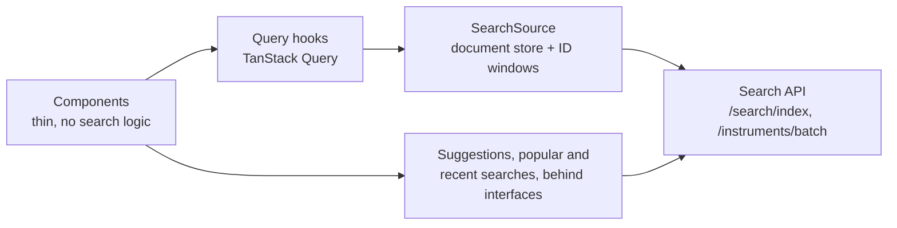

# Betashares Invest Coding Challenge: Search App

> **Reviewing this solution?** Setup is under [Solution](#solution) below. The design, decisions and demo flows are in **[`docs/walkthrough.md`](./docs/walkthrough.md)**.

## Table of contents

**The solution**

- [Setup](#setup): install, run and test
- [How it works](#how-it-works): what the app does
- [Architecture](#architecture): how the pieces fit together
- [Key decisions](#key-decisions): the main choices and why
- [Hard problems and how I solved them](#hard-problems-and-how-i-solved-them): the design problems that shaped it
- [Problems in the data](#problems-in-the-data): what is wrong with the data and what I did about it
- [How the work was run](#how-the-work-was-run): planning, tickets, decisions and review
- [How AI was used](#how-ai-was-used): what Claude did and what I did
- [Branding and accessibility](#branding-and-accessibility): matching the brand and the known WCAG gaps
- [Security notes](#security-notes): what is and isn't protected
- [What a real build would add](#what-a-real-build-would-add): left out on purpose
- [What isn't automated](#what-isnt-automated): what is checked by hand
- [Project layout](#project-layout) and [Project docs](#project-docs)

**The challenge as given**

- [Contents](#contents), [Candidate Instructions](#candidate-instructions) and the [assignment brief](./ASSIGNMENT.md)

---

This is a coding challenge to test your flair for building a search and filters page using a mock API as the backend.

You can build the app in React, Vue or Angular, and use any third-party libraries you wish.

## Contents

- [ASSIGNMENT.md](./ASSIGNMENT.md): the full assignment brief
- [api/](./api/): a local mock of the backend Search API, serving instrument data

## Candidate Instructions

Start with [ASSIGNMENT.md](./ASSIGNMENT.md).

Run the mock Search API from the repository root:

```bash
npm run api:install
npm run api        # http://localhost:8787
```
> **Note:** this setup is superseded by the solution's [Setup](#setup) below, which installs and runs the API and the web app together.

See [api/README.md](./api/README.md) for its endpoints, request format and examples.

---

# Solution

A search page for ASX-listed instruments, built in React against the mock Search API. You can search by ticker or name, narrow the results with seven filters, sort them, and load more. It also offers suggestions as you type, popular and recent searches, and a small insights panel for developers.

The stack is React 19, Vite and TypeScript, with Chakra UI v3 for the interface and TanStack Query for server data. The mock API is extended with a few additive endpoints, and the original ones are unchanged.

The design rests on three ideas:

- **The server does the filtering, sorting and counting.** The browser never works out a count or an order for itself.
- **Search returns IDs, a store holds the documents.** A search says which instruments match and in what order. Each instrument is fetched once and shared.
- **Data sources sit behind interfaces.** Components don't know how results, suggestions or popular searches are fetched, so a real endpoint can replace a mock without touching them.

**How it was designed and why:** [Architecture](#architecture), [Key decisions](#key-decisions) and [Hard problems](#hard-problems-and-how-i-solved-them) below give the overview, and [How the work was run](#how-the-work-was-run) covers the planning and process. [`docs/walkthrough.md`](./docs/walkthrough.md) has the full list of decisions with their trade-offs, and step-by-step demo flows.

## Setup

Requires Node 20.19 or later.

```bash
npm run setup   # installs the API and the web app
npm run dev     # runs both: API on http://localhost:8787, app on http://localhost:3000
```

Then open [http://localhost:3000](http://localhost:3000). Ctrl-C stops both servers.

You can also run them in two terminals, which is handy when you want to restart the API on its own:

```bash
npm run api     # terminal 1: mock Search API on http://localhost:8787
npm run web     # terminal 2: app on http://localhost:3000
```

To run the tests, use `npm test`. It runs the API suite and then the web suite, including a contract test that starts the real API on a spare port. You don't need a browser or any extra tooling.

## How it works

The app is a single page in [`web/`](./web/): a search input with a suggestions popup, popular search pills, a filter panel, sortable results and a "Load more" button. It's mobile-first, with a filter drawer on phones and a filter rail from 760px.

- **Searching.** Typing three or more characters fetches suggestions after a short pause: matching search terms and the top five instruments. Submitting a search (Enter, a suggestion, a popular pill or a recent search) runs it immediately.
- **ID-first results.** A search calls `POST /search/index`, which returns the total, all filter counts, the matching instrument IDs in order, and the first batch of instruments. The browser keeps each instrument it has loaded, so "Load more" and later searches fetch only the ones it doesn't have yet, from `POST /instruments/batch`. The server does all filtering, sorting and counting. See [ADR 0001](./docs/adr/0001-id-first-search-with-hydration.md).
- **Filters and sort.** Filter counts update as options are ticked. On tablet and desktop (760px and up) the results update with each tick and there is no button; in the phone drawer they update when the user presses "Show X results" ([ADR 0004](./docs/adr/0004-live-filters-on-tablet-and-desktop.md)). Sections narrow the results together; options within a section widen them. Sort sits above the results and applies straight away.
- **Popular and recent searches.** The API logs every submitted search. Popular searches are the most searched terms across all users that return results, deduped and protected against manipulation. They are demo data: the API seeds a fake history on its first start and then keeps the log in a file; the UI doesn't label it. When there is no popular data, or the fetch fails, the pills fall back to featured Betashares ETFs. Recent searches are the user's own last four, kept in the browser. Focusing the empty search box lists them, then the top five popular searches, in one popup. See [ADR 0002](./docs/adr/0002-server-side-search-log.md).
- **Analytics.** Searches are shown in the browser console with an `[analytics]` prefix. The gear in the header opens zero-result search terms from the API's log, and demo settings for page size, suggestion length and similar values.
- **API changes.** Two search endpoints and the search log are added to the mock in `api/`. Existing endpoints are unchanged. See [`api/README.md`](./api/README.md).
- **Styling.** Chakra UI v3, themed from [`DESIGN.md`](./DESIGN.md).

The gear icon in the header is there for this demo only. It opens the searches that found nothing, problems the page ran into, and a few demo settings. A production version of the page wouldn't have the gear at all.

## Architecture



A search is one plain object (term, filters, sort). It becomes one request, and the same object is the cache key, so a state the user has seen before costs no request. Each response carries a snapshot token (`indexed_at`). If the data changes underneath the user, the app drops its caches and reloads the first batch in place instead of mixing old and new results. A planning function works out which instruments the next batch is missing, and only those are fetched.

The search logic is plain TypeScript with no React, so it can be tested without rendering. The components stay thin and use theme tokens only, which is why the Betashares look could land as theme configuration.

## Key decisions

Each of these has more detail, and the options I rejected, in the linked record or the [walkthrough](./docs/walkthrough.md#decisions).

| Decision | Why |
| --- | --- |
| ID-first search with hydration ([ADR 0001](./docs/adr/0001-id-first-search-with-hydration.md)) | Counts stay correct at any scale because the server computes them. Each instrument is fetched once, and the design is ready for live prices and more markets. I rejected paging full documents and filtering in the browser. |
| Shape the backend contract | The frontend needs ordered IDs and counts, so I added endpoints for them and kept the originals pinned by tests. In a real team this is a contract the frontend helps design. |
| Popular searches from a server-side log ([ADR 0002](./docs/adr/0002-server-side-search-log.md)) | Only a server sees all users, and the server computes the counts so the browser can't fake them. Ranking by distinct users limits gaming. |
| Data sources behind interfaces | `SearchSource`, `SuggestionSource`, `PopularSource` and `RecentSearchStore` can each be swapped for a real endpoint, and tests use fakes. |
| Filters apply live on wide screens, on a button on phones ([ADR 0003](./docs/adr/0003-refinements-apply-on-button.md), [ADR 0004](./docs/adr/0004-live-filters-on-tablet-and-desktop.md)) | Beside the results a change shows straight away. On a phone the drawer covers the results, so the button's live total shows what you will get. |
| TanStack Query for server data | Typeahead races, cancelling stale requests and caching are the hard parts of this page, and it handles them. |
| Match the brand first, fix WCAG next ([ADR 0005](./docs/adr/0005-match-brand-then-fix-wcag.md)) | Matching the Betashares look was a requirement. Doing it exactly first leaves a before and after, and a measured list of accessibility fixes. |
| Everything runs from one `npm test` | Reviewers clone and run, so nothing should depend on browser or AI tooling. Layout is checked by hand using the demo flows. |

## Hard problems and how I solved them

Before any building, the plan went through five rounds of adversarial review by a second model (two independent reviews in the first round). It found real design flaws, and fixing them changed the architecture. These are the ones that mattered most. The full log is in [`docs/planning/`](./docs/planning/PLAN-REVIEW-LOG.md).

- **Consistency across batches.** Results arrive in windows of IDs, and the data can change between requests, for example when the API restarts or the index changes. Mixing batches from two versions would show wrong results. Every response carries a snapshot token (`indexed_at`), every follow-up request sends it back, and a mismatch returns a 409. The app then drops its caches and reloads the first batch in place. A lightweight `GET /version` lets it notice a restart, and responses that land after a reset are discarded.
- **Counting searches without breaking the cache.** Popular searches need every submitted search counted. But repeat searches are served from the browser cache and never reach the server, and a retry could be counted twice. I split logging from retrieval: `/search/index` stays pure and cacheable, and a small `POST /searches` records each submission, idempotent within a retry window. The server computes the result count itself, so the browser can't misreport it ([ADR 0002](./docs/adr/0002-server-side-search-log.md)).
- **Signals that mislead.** A search that returns nothing only because of the filters applied would look like a product gap in the insights. The server counts each term without filters. Spellings that dedupe to one key can return different results, so counts are worked out per spelling.
- **Faceted counts that stay correct.** Filters narrow across sections and widen within one, so each count has to ignore its own section. The server does this in one pass per active filter, not one search per option. Zero-count options are still returned so the UI can show them disabled, and a selected option is never disabled, so nobody gets trapped.
- **Popular searches visible to everyone.** Anything that reaches every visitor is an attack surface. Ranking uses distinct users and a minimum threshold, writes are rate limited, and the log is bounded with a defined eviction rule so a flood of unique terms can't exhaust memory. I documented this as demo-grade, and dropped a CORS allowlist idea because CORS isn't a security boundary and claiming it was would be false.
- **A contract the old API couldn't serve.** The first draft of `/search/index` reused the existing pagination fields, which clashed. It has its own fields, and the existing search code was refactored underneath it, with the original endpoints pinned by baseline tests written first. A fixed tie-break on ordering keeps windows stable between requests.
- **Races in the browser.** Typeahead, stale counts and late responses can overwrite newer ones. One canonical request object is both the request body and the cache key. Stale responses are dropped, and IDs the API reports as missing are skipped instead of breaking the page.

## Problems in the data

The mock data has quality problems, and I decided early that the frontend should show the data as given and not interpret it.

- **Look-alike issuers.** The same issuer appears under slightly different values, for example `investors_mutual` and `investors mutual`, or `etf_shares` and `etfshares`. They look like duplicates, but I can't be sure they mean the same thing.
- **Shared logos.** The same logo file is used for different issuers (`vaneck.png` is on Global X funds).
- **Missing data.** There is no display name for an issuer, and some logos are missing.
- **Overlapping units-on-issue ranges,** and a range that silently drops every ETF, since ETFs have no equity units.

What I did about each:

- I did not merge look-alike issuers. Guessing wrongly could hide or mix results, and cleaning the data is the backend's job. It is on the [roadmap](./docs/roadmap.md) as a backend fix.
- The issuer label is for display only, built from the value. The filter still uses the real value. When two labels collide, the "Show raw data" setting shows the raw value beside each so you can tell them apart.
- A missing logo falls back to a default image.
- The units range is labelled "Shares issued (equities only)", so the missing ETFs are no surprise.

## How the work was run

I ran this like a small team project, so the process is visible in the repo.

- **Plan first, and it took the longest.** I spent a working day on the plan before writing any code: about 7.5 hours in one session on 25 October (roughly 5 of them back and forth with Claude, the rest breaks). I worked out what the page had to do and what could go wrong with it, and every feature and risk went into the plan and the [roadmap](./docs/roadmap.md), which lists 68 items split into must-haves and extras. The plan is in [`docs/planning/`](./docs/planning/), with the glossary and the first three ADRs. A second model reviewed it for five rounds, and I made the calls when the reviewers and I disagreed, such as keeping all seven filters and the ID-first design, and dropping browser end-to-end tests. The review log is kept.
- **One ticket per slice.** Each piece of work is a GitHub issue with acceptance criteria and its blockers, built on its own branch.
- **Decisions on record.** When a decision changed the design, it went into an [ADR](./docs/adr/) with the options I rejected. ADR 0005 reverses a line in an earlier ticket, and says so.
- **Review before every merge.** Codex reviewed each change adversarially before its pull request. The pull request lists each finding and whether it was fixed or declined, with the reason.
- **I merged every pull request myself.**

## How AI was used

Claude Code (Anthropic) wrote most of the code, tests and documentation. A second model, OpenAI Codex, reviewed the changes before each pull request.

My part was strategy, architecture and quality control. Before any building started, I worked out the plan with Claude and settled the decisions that shape the app. Those are recorded in [`docs/adr/`](./docs/adr/) and the [walkthrough](./docs/walkthrough.md), with the options I rejected and why.

- Architecture: I chose the ID-first search design (the server returns ordered IDs and the browser fetches only the instruments it is missing), and the seams the UI depends on, so data sources can be swapped without touching components.
- API contract: I shaped the new endpoints around what the frontend needs, and kept the original endpoints unchanged so nothing already built could break.
- Risk and security: I decided how the popular searches are protected from gaming, and what the demo would and wouldn't claim to secure.
- Scope: I decided what to build, what to cut and what to leave documented as a next step.
- Frontend structure: I kept the search logic in plain TypeScript modules with no React, and the components thin, so the logic can be tested without rendering. I also set how server data is cached and kept fresh, so a changed search snapshot resets the app cleanly instead of showing stale results.
- Accessibility: I required a proper combobox pattern for the search input (labels, ARIA, keyboard use, focus handling and screen reader announcements), and automated checks for it with jest-axe.
- Responsive design: I built mobile first, with a filter drawer on phones and a filter rail on wider screens, and ruled out layout shifts and sticky bars that hide content.
- Design system: I kept components on Chakra's semantic tokens with no hard-coded colours, so the Betashares theme is configuration only. I corrected the automated brand extraction in `DESIGN.md` where it failed contrast (WCAG AA) or used the wrong body font.
- Testing strategy: I set the rule that everything runs from one `npm test` with no extra tooling, and decided which risks are covered by automated tests and which are checked by hand.

Then, for each piece of work, I:

- made the product and design calls, and changed the brief when I saw the result
- tried every change in the browser
- read and reviewed the code and the pull requests
- debugged problems as they came up, including bugs in earlier work
- merged every pull request myself

Each commit is under my name and ends with a `Co-Authored-By` line naming the model that wrote it.

## Branding and accessibility

The look follows the current Betashares branding and style guide, and matching it was an important requirement. I decided to match it exactly first and fix what falls short of WCAG 2.2 AA afterwards, so the gaps are known and listed here instead of missed.

What fails today, with the worst ratio for each (text needs 4.5:1, large text and outlines need 3:1):

- White text on the brand orange (`#fc4d16`), 3.38:1: the top strip, Search button, ticker pills, "Demo data" badge and checked controls.
- Orange text and icons on the grey page, 2.90:1: the page title, links and orange labels.
- Light grey text on light backgrounds, 2.24:1 to 4.19:1: placeholders, and disabled and zero-count filter options.
- Light outlines on form controls, 1.17:1 to 1.36:1: checkbox, radio and select borders.
- White inputs with no border on the grey page, 1.17:1: the search field.
- Text under 16px: pills, badges, tags, helper text, labels, counts and button labels.
- Hover orange with white text, 4.03:1: the Search button and links.

Everything else passes AA. Body text, muted text and the success, warning and error colours are at least 4.5:1 on both the grey page and the white cards. The search box is built as an accessible combobox (labels, ARIA and keyboard use), with jest-axe checks.

[`DESIGN.md`](./DESIGN.md) has the full list and where each item shows up. Each pair has a test that asserts it still fails by that amount, so the list can't go out of date. The decision is recorded in [ADR 0005](./docs/adr/0005-match-brand-then-fix-wcag.md). The fonts are loaded from the Betashares site and aren't in the repo.

## Security notes

This is a demo, and the API is a local mock, so security is a lot lighter than a real product would need. Here is what is and isn't protected.

- The app shows "popular searches" built from what people have searched. Anyone can see them, so someone could try to game the list. To make that harder, a term only counts once several different users have searched it, and it only appears if it actually returns results. Each user is also limited in how fast they can log searches.
- "Different users" is a guess. The browser makes up a random ID for itself and sends it with each search, and nothing proves it belongs to a real person. Someone who sends lots of made-up IDs could still push a term up. The speed limits slow that down but don't stop it, and they reset whenever the API restarts.
- The new endpoints check what they are sent. Unknown fields, bad values, badly formed IDs, requests over 32KB and very long search terms are rejected with a 400 error. The search log has a size cap and drops old entries, so a flood of unique terms can't fill up memory. The original endpoints behave exactly as they did before.
- There is no login. Anyone who can reach the API can read the zero-result terms and reset the popular searches. That is why the screen that uses them is development-only. The API also allows requests from any website, which is how the mock was set up. That is convenient for development but isn't a security measure.
- Text a user types is only ever shown as plain text, never run as HTML. This matters because logged search terms are displayed back in the insights view.
- `npm audit` reports no known vulnerabilities in `api/` or `web/`.

The reasoning for each choice is in the [walkthrough](./docs/walkthrough.md) and [ADR 0002](./docs/adr/0002-server-side-search-log.md).

## What a real build would add

The challenge is a demo, so these were left out on purpose. A real product would need them.

- A login for staff, so only they can see which searches found nothing and reset the popular searches.
- A proper way to know who a visitor is, and protection against bots and floods of requests at the front door of the system rather than inside the API.
- A database for the search log. Today it lives in a file next to the API, and it is lost if that file is deleted.
- A proper analytics system. At the moment searches are only printed in the browser console, with the same data kept in the API's log file. A real one would send them to a data warehouse and produce a regular report of what people searched for and didn't find.
- A dedicated endpoint for the suggestions as you type. The app currently builds them from two existing calls. The code is already set up so the endpoint can be swapped in.
- "Did you mean" for typos, for example someone typing `VSG` when they mean `VGS`.
- An error reporting service in place of the browser console, and a font file the project owns. The Betashares font (Rund Text) is loaded from another website here, with Inter as the backup, because I haven't confirmed I'm allowed to include the font files.
- Prices and performance, if the data included them. The mock doesn't have any.

The full list is in the [roadmap](./docs/roadmap.md).

## What isn't automated

`npm test` runs the whole automated suite. It checks the API, the search logic, the page talking to a real running API, and the on-screen components, including keyboard use and screen reader labels. It can't check how the page looks.

I didn't add a browser-based test, because the tool for it needs hundreds of megabytes of extra downloads for a single check. So these are checked by hand using the demo flows in the [walkthrough](./docs/walkthrough.md):

- the layout on a phone, a tablet and a desktop
- using the page with a real screen reader

## Project layout

- [`api/`](./api/): the mock Search API that came with the challenge. The original endpoints are unchanged. I added new ones for searching, fetching instruments in bulk and recording searches.
- [`web/`](./web/): the search page, built with React. The search logic sits in plain TypeScript files that can be tested on their own, and the screen components stay small.
- [`docs/`](./docs/): the walkthrough, the decision records, the roadmap and the planning notes.

## Project docs

| File | What's in it |
| --- | --- |
| [`docs/walkthrough.md`](./docs/walkthrough.md) | **Start here:** architecture, decisions, demo flows |
| [`docs/adr/`](./docs/adr/) | Architecture decision records |
| [`docs/roadmap.md`](./docs/roadmap.md) | Features, grouped by body of work, MVP vs extra |
| [`CONTEXT.md`](./CONTEXT.md) | Domain glossary |
| [`DESIGN.md`](./DESIGN.md) | Design system used for the theme |
| [`docs/design/betashares-extraction.md`](./docs/design/betashares-extraction.md) | Raw brand extraction from betashares.com.au, kept for reference |
| [`docs/planning/`](./docs/planning/) | The locked plan and its review log |
